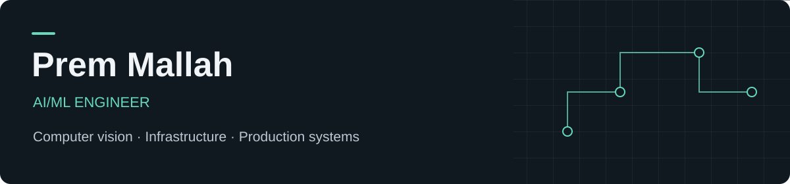

I'm Prem, an AI/ML engineer interested in where models meet real systems. I work on computer vision, production inference, distributed services, and the infrastructure that keeps them running.

[Website](https://premmallah.com) · [Interactive labs](https://premmallah.com/labs/) · [LinkedIn](https://www.linkedin.com/in/premmallah/)

## Selected work

### Prem's Labs

Interactive computer engineering experiments you can explore in your browser. The collection covers systems architecture, networking, and bit-level concepts.

| Lab | Explore |
| :--- | :--- |
| [CPU Pipeline Simulator](https://premmallah.com/labs/systems/cpu-pipeline/) | Step through a five-stage instruction pipeline, with data hazards, forwarding, and stalls. |
| [TCP Congestion Control](https://premmallah.com/labs/networking/tcp-congestion-control/) | Compare TCP Reno and Tahoe as the congestion window responds to acknowledgements and packet loss. |
| [Binary / Hex Playground](https://premmallah.com/labs/binary/) | Manipulate individual bits, convert between bases, and explore two's complement. |

[Explore all labs →](https://premmallah.com/labs/)

### Production AI systems

At **Closyss Technologies**, I work as a **Jr. AI Developer** (March 2026 onward), following an AI Developer internship. My work covers computer vision and the systems around it:

- YOLO and PyTorch inference pipelines that turn live video into structured events.
- Event processing and service communication with Kafka, WebSockets, and REST APIs.
- Containerized deployment, cloud infrastructure, and edge hardware integration.

These are general areas of my work; implementation details remain private. [More on my website →](https://premmallah.com/#work)

## Tools I work with

| Area | Technologies |
| :--- | :--- |
| AI & inference | PyTorch, YOLO, ONNX, TensorRT |
| Systems & data | Docker, Apache Kafka, PostgreSQL, Linux |
| Cloud | AWS, Azure, OCI |
| Video & networking | RTSP, WebRTC, HLS, WebSockets |
| Languages | Python, Java, JavaScript, SQL |

## Selected certifications

- **AWS** · Certified Solutions Architect – Associate (SAA-C03)
- **Microsoft** · Certified: Azure Fundamentals
- **GitHub** · GitHub Foundations
- **Oracle** · Oracle Cloud Infrastructure 2025 Certified Architect Associate
- **Oracle** · Oracle Cloud Infrastructure 2025 Certified Networking Professional

Selected AI learning

Course completions and training:

- **NPTEL** · Applied Accelerated Artificial Intelligence; Big Data Computing
- **NVIDIA** · Fundamentals of Deep Learning; Applications of AI for Anomaly Detection

[More credentials and learning on LinkedIn →](https://www.linkedin.com/in/premmallah/)

---

Interested in computer vision, production AI, or systems engineering? Find me on [LinkedIn](https://www.linkedin.com/in/premmallah/) or explore [premmallah.com](https://premmallah.com).
